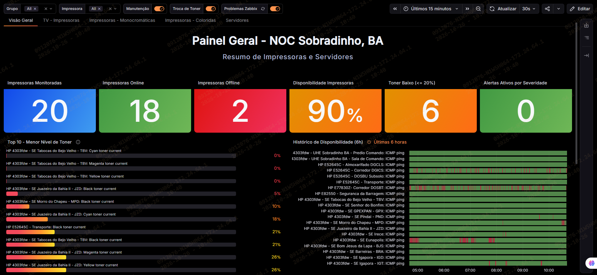
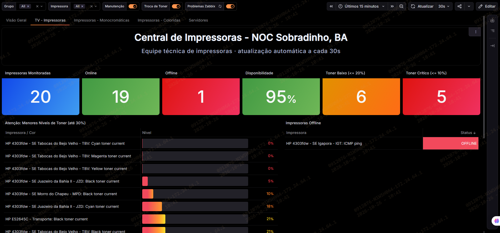
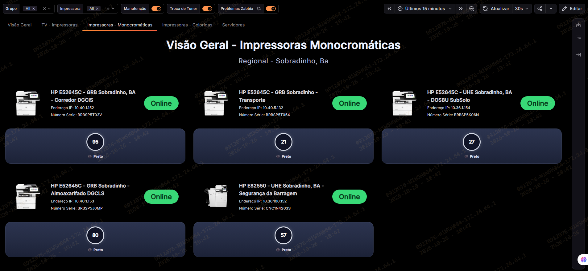
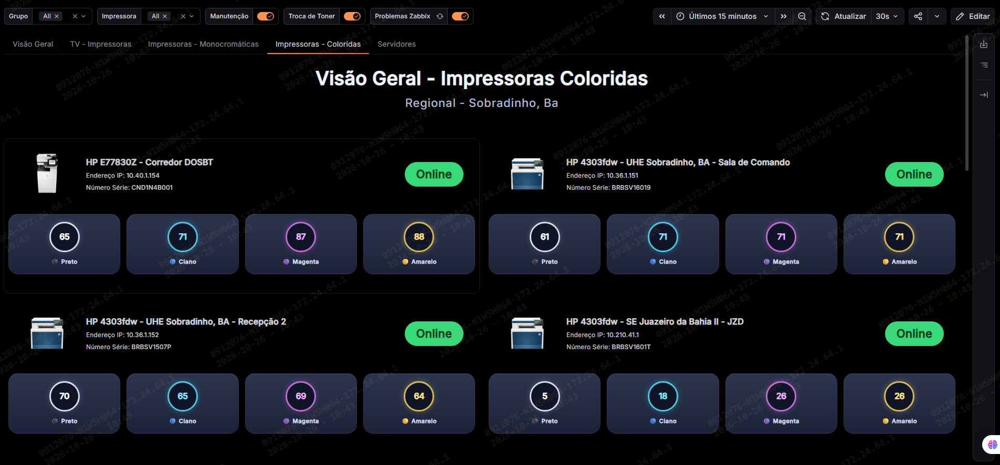
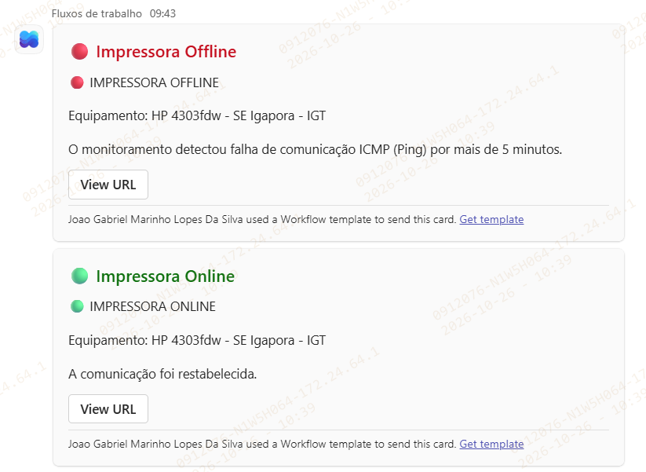
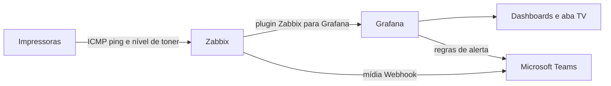

# 🖨️ NOC Impressoras: Monitoramento com Zabbix, Grafana e Microsoft Teams


Painel de monitoramento do parque de impressoras de uma operação com várias localidades. O projeto reúne, em um único dashboard do Grafana, a **disponibilidade** e o **nível de toner** de cada equipamento, com **alertas automáticos no Microsoft Teams** e uma **tela de TV** para a equipe técnica.

> **Contexto:** a equipe só descobria impressora parada ou toner acabando quando o usuário abria um chamado. O objetivo foi trocar o atendimento reativo por acompanhamento em tempo real, usando ferramentas já existentes.

---

## 📸 Capturas de tela

> Use apenas imagens **anonimizadas** (sem IPs, números de série, nomes reais de equipamentos e marca d'água corporativa). Veja a seção [Segurança e privacidade](#-segurança-e-privacidade).

| Visão Geral | TV - Impressoras |
|---|---|
|  |  |

| Impressoras Monocromáticas | Impressoras Coloridas |
|---|---|
|  |  |

| Alerta no Teams |
|---|
|  |

---

## ✨ Funcionalidades

- **Visão Geral** com indicadores de impressoras monitoradas, online, offline, disponibilidade, toner baixo e alertas por severidade.
- **Top 10 de menor nível de toner**, da cor mais crítica para a mais cheia.
- **Histórico de disponibilidade** em linha do tempo por impressora.
- **Aba TV** para exibição em tela de parede, com números grandes, lista de toners críticos e lista de impressoras offline.
- **Cartões por impressora** (monocromáticas e coloridas) com status online/offline e nível de cada cor, com alerta visual de toner baixo.
- **Filtros** por grupo (localidade) e por impressora.
- **Anotações** no gráfico para manutenção, troca de toner e problemas do Zabbix.
- **Atualização automática** a cada 30 segundos.
- **Alertas no Microsoft Teams** de impressora offline/restabelecida e de toner baixo.

---

## 🏗️ Arquitetura



| Componente | Função |
|---|---|
| **Zabbix** | Coleta a disponibilidade (ICMP ping) e o nível de toner de cada cartucho. |
| **Grafana** + plugin Zabbix | Exibe os painéis e avalia as regras de alerta. |
| **Microsoft Teams** (Workflows) | Recebe as notificações em formato de cartão. |

Há dois caminhos de alerta, e o ideal é usar **um por tipo de alerta** para não duplicar mensagens:

1. **Zabbix → Teams**: mídia Webhook do Zabbix (indicada para problemas e impressora offline).
2. **Grafana → Teams**: regras de alerta do Grafana (indicadas para toner baixo).

---

## 📊 Painéis

| Aba | Conteúdo |
|---|---|
| **Visão Geral** | Indicadores, ranking de toner e histórico de disponibilidade. |
| **TV - Impressoras** | Visual de parede para a equipe técnica. |
| **Impressoras - Monocromáticas** | Um cartão por impressora com status e nível de toner preto. |
| **Impressoras - Coloridas** | Um cartão por impressora com status e níveis das 4 cores. |
| **Servidores** | Acompanhamento da infraestrutura de monitoramento. |

### Regras de nível de toner

| Faixa | Situação |
|---|---|
| Até 10% | Crítico |
| Até 20% | Baixo |
| Até 40% | Atenção |
| Acima de 40% | OK |

---

## ✅ Pré-requisitos

- Zabbix com as impressoras cadastradas como hosts, coletando os itens **`ICMP ping`** e **`<Cor> toner current`** (Black, Cyan, Magenta, Yellow).
- Grafana com o plugin [Zabbix](https://grafana.com/grafana/plugins/alexanderzobnin-zabbix-app/) instalado e habilitado.
- Um datasource Zabbix configurado no Grafana.
- Um canal do Microsoft Teams com um fluxo de webhook (Workflows).
- Python 3 (apenas para o script opcional de criação das regras de alerta).

---

## 🚀 Instalação

### 1. Zabbix

1. Cadastre cada impressora como host, em um grupo de hosts por localidade.
2. Confirme que cada host coleta `ICMP ping` e os itens de toner.
3. (Opcional) Crie um usuário de serviço **somente leitura** para o Grafana.

### 2. Grafana: datasource e plugin

1. Instale e habilite o plugin Zabbix.
2. Em **Connections → Data sources**, adicione o Zabbix e teste a conexão.
3. Anote o **UID** do datasource (aparece na URL da tela de edição).

### 3. Importar o dashboard

1. Em **Dashboards → New → Import**, envie o arquivo `dashboards/noc-impressoras.json`.
2. Selecione o datasource Zabbix quando solicitado.

> Se o seu dashboard usa o UID do datasource dentro do JSON, substitua pelo UID do seu ambiente antes de importar.

### 4. Ajustar variáveis e filtros

- Variável **Grupo**: ajuste a expressão regular para os nomes dos seus grupos de hosts.
- Variável **Impressora**: o filtro de host padrão é `/^HP /`. Altere para o padrão de nome das suas impressoras.

### 5. Anotações

As anotações manuais funcionam por tag:

| Tag | Uso |
|---|---|
| `manutencao` | Registrar uma manutenção |
| `troca-toner` | Registrar a troca de um cartucho |

Para registrar, use Ctrl + clique no gráfico e informe a tag. Salve o dashboard depois.

### 6. Alertas no Teams

**Opção A: Zabbix → Teams**

1. Em **Alertas → Tipos de mídia**, importe `alerting/zabbix_mediatype_teams.yaml`.
2. Preencha `teams_endpoint` (URL do webhook) e `zabbix_url`.
3. Crie um usuário com essa mídia e uma **Ação** de trigger que envie a mensagem (inclua a operação de recuperação).
4. Teste pelo botão **Testar** do tipo de mídia.

**Opção B: Grafana → Teams**

1. Edite as variáveis no início de `alerting/grafana_configurar_alertas_teams.py`.
2. Execute:

```bash
python alerting/grafana_configurar_alertas_teams.py
```

O script cria a pasta, o ponto de contato do Teams e as regras de **impressora offline** (ping sem resposta por 5 minutos) e **toner baixo** (abaixo de 20%).

---

## 🗂️ Estrutura do repositório

```text
.
├── README.md
├── dashboards/
│   └── noc-impressoras.json          # dashboard (sem dados sensíveis)
├── alerting/
│   ├── zabbix_mediatype_teams.yaml   # mídia do Teams para o Zabbix
│   └── grafana_configurar_alertas_teams.py
└── docs/
    └── images/                       # capturas anonimizadas
```

---

## 🧰 Solução de problemas

| Sintoma | Causa provável | O que fazer |
|---|---|---|
| `non-metrics are not supported` ao criar o alerta | O alerta do Grafana só aceita consultas do Zabbix no modo **Metrics**; o painel de problemas usa outro modo | Crie a regra com consulta em modo Metrics (ping e toner) e use a mídia do Zabbix para problemas gerais |
| Lista de Grupo ou Impressora vazia | Datasource não selecionado ou expressão regular que não casa com os nomes | Revise o datasource e a regex da variável |
| Nome do host vazio no texto do alerta | O plugin pode devolver rótulos com outros nomes | Use o **Preview** da regra para ver os rótulos disponíveis |
| Anotações não aparecem | Tag diferente da esperada ou dashboard não salvo | Use `manutencao` e `troca-toner` e salve |
| Nomes muito longos nas tabelas | O Zabbix devolve host e item no nome da série | Ajuste com transformações de renomeação |
| Previsão de toner distorcida | Cartucho trocado no período faz o nível voltar a 100% | Considere apenas períodos sem troca |

---

## 🔐 Segurança e privacidade

- **Nunca** versione a URL do webhook do Teams, tokens do Grafana ou credenciais do Zabbix. Use variáveis de ambiente ou um cofre de senhas.
- Antes de publicar prints ou o JSON do dashboard, remova **IPs, números de série, nomes reais de equipamentos e localidades**, nomes de usuários e marcas d'água corporativas.
- Se o webhook do Teams já foi exposto, **gere uma nova URL** no Workflows.
- Sugestão de `.gitignore`:

```gitignore
*.env
secrets/
*webhook*.txt
```

---

## 🗺️ Roadmap

- [ ] Painel **Suprimentos e Compras** (cartuchos a repor por cor).
- [ ] **Previsão de fim de toner** com base no consumo dos últimos 30 dias.
- [ ] Painel de **Disponibilidade e SLA** (30 dias).
- [ ] Extensão para switches, servidores e links.
- [ ] Alerta de ausência de dados do Zabbix.

---

## 🤝 Contribuindo

Sugestões e melhorias são bem-vindas. Abra uma *issue* descrevendo o cenário ou envie um *pull request* com as alterações.

## 📄 Licença

Distribuído sob a licença MIT. Veja o arquivo `LICENSE` (adicione o seu antes de publicar).

## 👤 Autor

**João Silva** · Infraestrutura de TI
Conecte-se no LinkedIn: _[adicione o link do seu perfil]_
